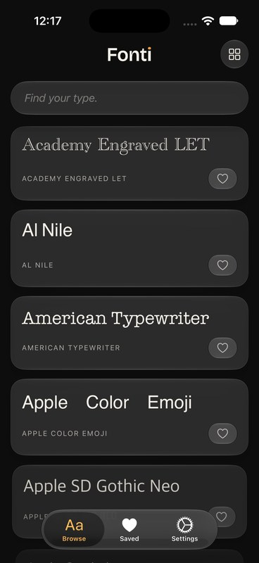
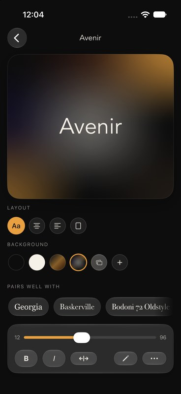
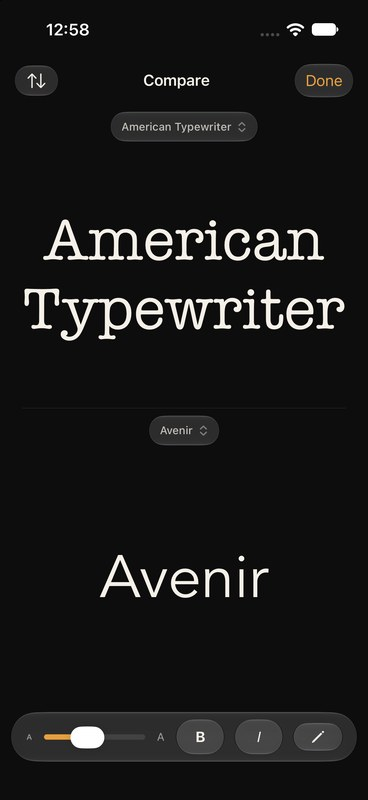
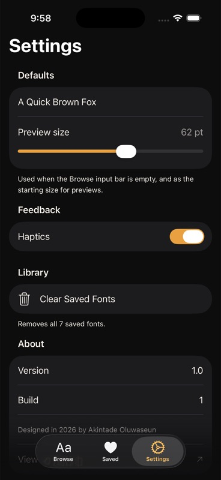
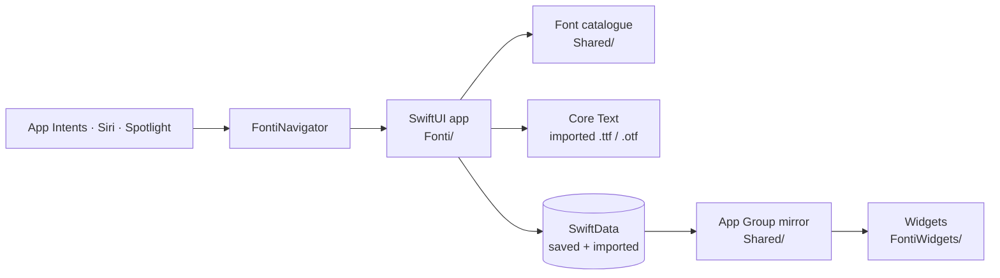

<p align="center">
  
</p>

<h1 align="center">Fonti</h1>

<p align="center">Find your type.</p>

There are hundreds of typefaces on an iPhone and no real way to look at them. The system picker shows a list of names, so choosing a face means reading the word "Baskerville" set in Helvetica and imagining the rest. Designers end up screenshotting, pinching and guessing.

Fonti renders *your* words in every font on the device. Type a line and the whole library re-sets itself in front of you. Open one and you get a full specimen — four layouts, warm backgrounds, size, weight, tracking and leading — plus the faces a designer would pair it with, a side-by-side compare, and a shortlist you can keep.

## Try it

- **App Store:** https://apps.apple.com/gb/app/fonti-find-your-type/id6777232340

<p align="center">
  
  
  
  
</p>

There is no web build. Fonti reads the fonts installed on the device, so it only means anything on a real one.

## How it uses Apple Intelligence and iPhone Duo

**Apple Intelligence**

- **Ask for a face.** "Find me a serif" or "find monospace fonts" resolves through `FindFontsIntent` against the device's own catalogue, classified by measured proportions rather than a hardcoded list.
- **Ask about this one.** While a specimen is open the screen is annotated with that typeface as a `FontEntity`, so "what pairs with this?" and "find something like this" bind to the right face without naming it.
- **Similar, by measurement.** `FindSimilarFontsIntent` compares x-height, width and stroke contrast, so "something like Futura" returns geometric sans faces rather than string matches.
- **Spotlight.** Every family is indexed, including imported ones, so a font is reachable from search without opening the app.
- **Shortcuts.** Find Font Pairings, Find Similar Fonts, Compare Fonts and Show Saved Fonts are all exposed as App Shortcuts.

**iPhone Duo**

- **Both panels.** The cover screen gets a single column; the inner display reports regular in both size classes and gets a split view — list on the left, live specimen on the right.
- **System bars, not hand-rolled.** Toolbars and the tab bar move to the vertical strip on the trailing edge because Fonti uses standard components rather than reimplementing them.
- **Compare across the hinge.** The compare screen is an `ArrangementView`, so a partially folded device seats each typeface on its own half of the book instead of letting one straddle the fold.
- **Reachable controls.** On the inner display the settings column sits low, within thumb reach of a two-handed grip, and the size and style controls float over the canvas they affect.

[docs/designing-for-iphone-duo.md](docs/designing-for-iphone-duo.md) is the working reference: Apple's guidance, the iOS 27.1 APIs, measured display specs, and what had to change here.

## Built with

| Tool | What it does in Fonti |
|---|---|
| **SwiftUI** | Every screen. `NavigationSplitView` on wide displays, `ArrangementView` for compare, `Layout` for the glyph flow, and `ImageRenderer` for specimen export |
| **Liquid Glass** | `.glassEffect(in:)` on the search bar, control capsule and pairing chips; the system tab bar provides its own |
| **SwiftData** | `SavedFont` and `ImportedFont`, with `@Attribute(.unique)` on the family name |
| **App Intents** | Font and category entities, four App Shortcuts, and onscreen annotation so "this" resolves to the face on screen |
| **Core Spotlight** | Indexes every family, system and imported, with a fingerprint so re-indexing only happens when the font set changes |
| **Core Text** | Registers imported `.ttf` and `.otf` files so they appear in Browse beside the system faces |
| **WidgetKit** | A specimen widget with a configurable face, backed by an App Group mirror of the saved store |
| **XCTest + AppIntentsTesting** | Runs the intents out of process, the way Siri does, against the installed app |

No third-party dependencies.

## Architecture



Everything an intent, a widget or Spotlight needs lives in `Shared/`, because the app's SwiftData store is inside the app container and those processes cannot read it. The saved list is mirrored into an App Group so an intent can answer "what have I saved?" without launching the app.

| Path | What it is |
|---|---|
| `Fonti/` | The app — `App/`, `Features/`, `Services/`, `Theme/`, `Models/`, `Intents/` |
| `FontiWidgets/` | Home and Lock Screen widgets, with their configuration intent |
| `Shared/` | Code the app, widgets and intents all need: font catalogue, pairings, availability, colour tokens, App Group mirrors, Spotlight indexer |
| `FontiIntentTests/` | Out-of-process App Intents tests (a UI testing bundle, not a hosted unit test — `AppIntentsTesting` talks to the installed app over XPC) |
| `docs/` | Design notes, the iPhone Duo reference, and the App Store screenshot pipeline (`docs/appstore/compose.py`) |

## Running locally

Needs **Xcode 27.1 or later** and an **iOS 27.1** simulator or device.

```sh
git clone https://github.com/tade-dev/Fonti.git
cd Fonti
open Fonti.xcodeproj
```

Pick a simulator and ⌘R. The deployment target is iOS 27.0, but `ArrangementView` in the compare screen is an iOS 27.1 API, so the 27.1 SDK is required to build. Xcode 27.1 is currently a beta, so release builds for the App Store need a non-beta SDK until it ships.

To see the foldable layouts, pick **iPhone Duo** in Device Hub and use the fold buttons in its bottom toolbar; hold ⌥ while dragging for partial hinge angles. There is no `simctl` equivalent — folding is GUI only.

## Tests

```sh
xcodebuild test -project Fonti.xcodeproj -scheme Fonti \
  -destination 'platform=iOS Simulator,name=iPhone 18 Pro'
```

19 tests covering intent resolution, classification search, similarity, pairings, compare, Spotlight indexing and onscreen annotation. They run against the installed app over XPC, so they exercise the real Apple Intelligence surface rather than mocks.

The suite needs the app to have completed onboarding — on a freshly erased simulator the Spotlight and onscreen-entity tests fail because the indexer only runs once `RootView` appears.

## Licence

MIT, an OSI-approved licence. See [LICENSE](LICENSE).

## Credits

Designed and built in 2026 by **Akintade Oluwaseun**. The icon is an *Aa* specimen — cream A, amber a — on the brand ink `#0D0D0D`.
